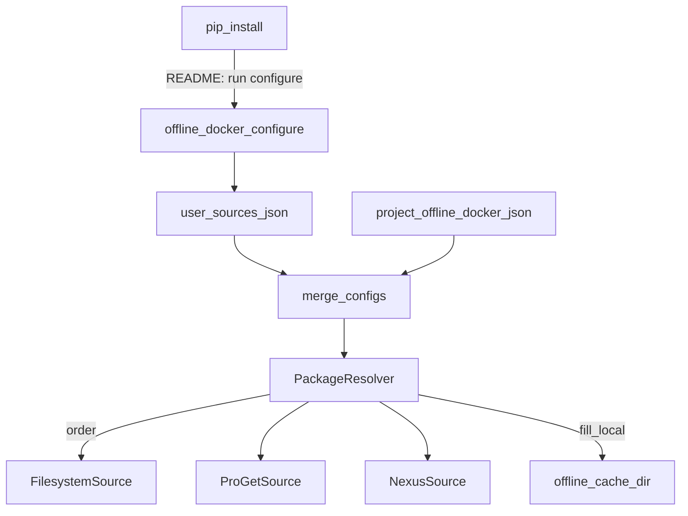

# План: мульти-источники offline-cache (local / Nexus / ProGet)

## Цель

Утилита ищет и ставит пакеты **по цепочке источников** с приоритетом порядка: сначала локальный `offline-cache/`, затем ProGet/Nexus (если настроены), опционально upstream. Найденное с remote при `fill_local: true` дописывается в локальную папку.

Имена рабочих команд (`download-*`, `build-offline`, `validate-*`, …) **не меняются**. Единственное добавление CLI — **`offline-docker configure`** для первичной настройки репозиториев.

## Зафиксированные решения

- Стратегия resolve: **first-hit** по `resolve.order`.
- Локальный `offline_cache` **всегда** на диске (Docker bind-mount); remote — источники, не замена mount.
- **[`examples/offline-docker.json.example`](examples/offline-docker.json.example) остаётся нейтральным** — без корпоративных URL; опционально только закомментированная/пустая схема `cache` с плейсхолдерами `https://…`.
- Корпоративные URL **не** живут в project-example и **не** хардкодятся как обязательный default в коде.
- Настройка URL: интерактивно через **`offline-docker configure`** (см. ниже про pip).
- **Пустые URL / нет user-config → режим по умолчанию: только offline-cache** (`order: ["local"]`).
- Auth: per-source через env (`auth_env`), без секретов в JSON.
- Приоритет конфигов: **project `.offline-docker.json` перекрывает user-config** (если в проекте явно задан `cache`); иначе берётся user-level.

## Настройка при установке (pip)

Интерактивный prompt **внутри `pip install` не делаем**: ломает CI, non-interactive install, wheel-only окружения и не поддерживается нормально modern packaging.

Вместо этого (эквивалент «спросить при установке»):

1. После `pip install` в README/epilog CLI явно:  
   `offline-docker configure`
2. Команда `configure` (TTY):
   - ProGet base URL (Enter = пропустить)
   - имена feeds (с подсказками-плейсхолдерами, не обязательными default)
   - Nexus base URL (Enter = пропустить)
   - имена repos
   - порядок resolve (default: `local`, затем заполненные remote)
3. Пишет **user-level** файл, не трогая example и не требуя править каждый проект:
   - Linux/macOS: `~/.config/offline-docker/sources.json`
   - Windows: `%APPDATA%/offline-docker/sources.json`
4. Non-interactive: `offline-docker configure --proget-url … --nexus-url …` или пропуск → local-only.
5. `pip install` в CI без `configure` = только offline-cache (как сейчас по сути).

Опционально позже: при первом `discover`/`download-*` в TTY, если user-config отсутствует — одноразовое предложение «запустить configure? [y/N]» (не блокер этапа 1).

## Известные корпоративные feeds (справочно для configure / внутренней доки)

Не класть в public example. Использовать как **подсказки в help `configure`** и в операторской заметке README (секция «корп. контур»), поля при промпте по умолчанию **пустые**:

**ProGet** (`https://proget.example.com`):

| Feed | Назначение |
|------|------------|
| `pypi-feed` | PyPI |
| `npm-feed` | npm |
| `local-deb` | deb |
| `local-docker` / `docker-<name>` / `repository` | docker |
| `local-rpm` | rpm (вне скоупа v1) |
| nuget-* | вне скоупа |

Индексы после configure (если пользователь ввёл URL):

- PyPI: `https://proget.example.com/pypi/pypi-feed/simple`
- npm: `https://proget.example.com/npm/npm-feed/`

**Nexus** (`http://nexus.example.com:8081`, Sonatype Nexus OSS 3.69):

| Repo | Тип | Назначение в CLI |
|------|-----|------------------|
| `pypi-group` | group | основной PyPI index (hosted+proxy) |
| `pypi-hosted` | hosted | выкладка своих wheels |
| `pypi-proxy` | proxy | только upstream-proxy |
| `npm-group` | group | основной npm registry |
| `npm-hosted` / `npm-proxy` | hosted/proxy | аналогично |
| nuget-*, maven-* | — | вне скоупа v1 |
| прочие репозитории организации | — | вне скоупа v1 |

В `configure` по умолчанию предлагать (как подсказку, поле всё равно можно оставить пустым):

- base: `http://nexus.example.com:8081`
- pypi repo: `pypi-group`
- npm repo: `npm-group`

Индексы Nexus 3:

- PyPI: `http://nexus.example.com:8081/repository/pypi-group/simple`
- npm: `http://nexus.example.com:8081/repository/npm-group/`

Учесть HTTP (не HTTPS) в доке: для pip/npm в корпсети обычно ок; при необходимости `trusted-host` / `npm strict-ssl false` — задокументировать в README корп. контура, не включать в нейтральный example.

## Архитектура



Слои кода:

- [`src/offline_docker/user_config.py`](src/offline_docker/user_config.py) — путь, load/save `sources.json`
- [`src/offline_docker/configure.py`](src/offline_docker/configure.py) — интерактив / флаги
- [`src/offline_docker/sources/`](src/offline_docker/sources/) — интерфейс + реализации
- [`src/offline_docker/resolve.py`](src/offline_docker/resolve.py) — цепочки index URL по order

Merge в [`config.py`](src/offline_docker/config.py) / [`context.py`](src/offline_docker/context.py):

1. База: только `filesystem` (local-only).
2. Если есть user-config с непустыми URL → добавить proget/nexus в sources и order.
3. Если в project JSON есть `cache` → полностью или частично перекрывает user (явный project wins).

## Схема user-config (после configure)

```json
{
  "sources": [
    { "name": "local", "type": "filesystem" },
    {
      "name": "proget",
      "type": "proget",
      "url": "https://proget.example.com",
      "feeds": { "pypi": "pypi-feed", "npm": "npm-feed", "deb": "local-deb" },
      "auth_env": "PROGET_API_KEY",
      "enabled": true
    },
    {
      "name": "nexus",
      "type": "nexus",
      "url": "http://nexus.example.com:8081",
      "repos": { "pypi": "pypi-group", "npm": "npm-group" },
      "auth_env": "NEXUS_AUTH",
      "enabled": true
    }
  ],
  "resolve": {
    "order": ["local", "proget", "nexus"],
    "fill_local": true,
    "on_miss": "fail"
  }
}
```

Пример выше — **после** успешного `configure` с обоими URL. Если ProGet/Nexus URL пустые → `enabled: false`, `order: ["local"]`.

Нейтральный project-example: секции `cache` либо нет, либо с пустыми `"url": ""` / комментарием в `examples/README.md`.

Env-override: `OFFLINE_RESOLVE_ORDER=local,proget,nexus`.

## Этапы реализации

### Этап 1 — user-config + configure + index chain (wheels/npm)

1. `user_config.py`: resolve path, load/save, empty → local-only.
2. `configure` в [`cli.py`](src/offline_docker/cli.py): интерактив + non-interactive флаги; Enter пропускает remote.
3. Dataclass'ы `CacheSource`, `ResolveConfig`; merge user ≺ project.
4. `sources/`: `FilesystemSource`, `UpstreamSource`, `ProGetSource`/`NexusSource` (пока сбор URL из config).
5. `PackageResolver` → ordered pypi/npm URLs.
6. [`download_wheels.py`](src/offline_docker/download_wheels.py): `--find-links /wheels`, затем index/extra-index по order; `--dest /wheels` = fill_local.
7. [`download_npm.py`](src/offline_docker/download_npm.py): registry из первого npm source (local-only → прежнее поведение / skip online registry если strict).
8. `discover` — блок Sources (user vs project).
9. Тесты: empty config = local-only; merge; порядок URL; configure non-interactive.

**Результат:** после pip install без configure — только offline-cache; после configure с ProGet/Nexus — цепочка с приоритетом.

### Этап 2 — Nexus raw materialize/publish

1. HTTP-клиент raw repo; auth из `auth_env`.
2. Materialize в `offline_cache` перед build/download при nexus в order.
3. Optional `publish: true` (default false).

### Этап 3 — ProGet fully

1. Feeds из user-config (`pypi-feed`, `npm-feed`, `local-deb`, …).
2. Universal/Asset feed для зеркала папки — если появится в ProGet; иначе только proxy feeds.
3. Тот же materialize/publish контракт.

### Этап 4 — debs + документация

1. Apt через `local-deb` / Nexus apt proxy.
2. README: `pip install` → `offline-docker configure` → пустой Enter = local-only; example нейтральный.
3. Yarn/docker/trivy — follow-up.

## Изменения по файлам (этап 1)

- `src/offline_docker/user_config.py` — новый
- `src/offline_docker/configure.py` — новый
- `src/offline_docker/cli.py` — subcommand `configure`
- `src/offline_docker/config.py` — merge cache
- `src/offline_docker/sources/*.py`, `resolve.py` — новые
- `download_wheels.py`, `download_npm.py`, `discover.py`, `context.py` — врезка
- `tests/test_user_config.py`, `test_resolve.py`, доп. к `test_config.py`
- `examples/offline-docker.json.example` — **без** корп. URL
- `examples/README.md`, `README.md` — инструкция configure

## Вне скоупа

- Интерактив внутри самого `pip install` (setuptools install hook)
- Корп. URL в public example
- Смена имён существующих рабочих команд
- Параллельный поиск без приоритета

## Критерий готовности

- Чистый install без configure → только local offline-cache, тесты зелёные.
- `configure` с пустым вводом → `sources.json` с local-only.
- `configure` с ProGet URL → download-wheels/npm используют `pypi-feed` / `npm-feed` после local.
- Example JSON без `proget.example.com`.
- `discover` показывает активную цепочку и источник конфига (user/project).
