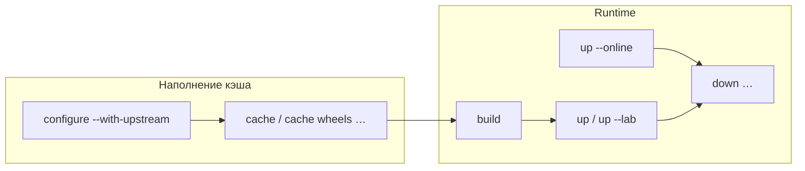

# План: CLI `offdock` и короткие команды

## Зафиксированные решения

- Бинарь: **`offdock`** (понятнее, чем `odock`).
- Версия: **`2.0.0`** (semver major: публичный CLI UX ломается; aliases только на переход).
- Конфиг проекта **не трогаем**: `.offline-docker.json`, пакет `offline_docker`, имя дистрибутива `offline-docker-cli`.
- Online-режим **оставляем**, флаг: **`--online`** (не `--dev`).
- Cache: **группа** (`cache`, `cache wheels`, …).
- Load: **`cache load`** (не голое `load`).
- Scan: **`scan trivy <target> [image]`**, короткий alias **`scan <target>`** = trivy.
- `down` — новый, с `services` и теми же режимами, что `up`.
- Старые имена команд — **deprecated aliases** (1–2 релиза), затем удаление отдельным изменением.

## Целевой UX

```text
offdock configure […]
offdock init [--dry-run]
offdock discover
offdock tui

offdock cache                    # полный download (бывш. download-offline-cache)
offdock cache wheels|debs|npm|yarn|images|trivy
offdock cache check              # бывш. validate-offline-cache
offdock cache load               # *.tar → docker load

offdock build [base|backend|frontend…] [--no-cache]
offdock up [--lab|--online] [--no-build] [--no-deps] [--no-cache] [services…]
offdock down [--lab|--online] [services…]

offdock scan trivy backend|frontend [image]
offdock scan backend|frontend [image]   # alias → trivy
```

Режимы `up`/`down` (взаимоисключающие `--lab` и `--online`):

| Команда | Compose |
|---------|---------|
| `up` / `down` | `compose_up_offline` |
| `… --lab` | `compose_up_offline_lab` |
| `… --online` | `compose_online` (бывший `dev-up`) |



## Alias-таблица (старое → новое)

| Старое | Новое |
|--------|--------|
| `offline-docker` (script) | `offdock` (+ alias script) |
| `download-offline-cache` | `cache` |
| `download-wheels` | `cache wheels` |
| `download-debs` | `cache debs` |
| `download-npm-cache` | `cache npm` |
| `download-yarn-cache` | `cache yarn` |
| `download-docker-images` | `cache images` |
| `download-trivy-db` | `cache trivy` |
| `validate-offline-cache` | `cache check` |
| `load-docker-images` | `cache load` |
| `build-offline` | `build` |
| `build-base-offline` | `build base` |
| `up-offline` | `up` |
| `up-offline --lab` | `up --lab` |
| `dev-up` | `up --online` |
| `scan-trivy-offline` | `scan trivy` / `scan` |
| *(нет)* | `down` |

## Изменения по файлам

### 1. Точка входа и argparse — [`src/offline_docker/cli.py`](src/offline_docker/cli.py)

- `prog="offdock"`, обновить все epilog/примеры.
- Два entry в [`pyproject.toml`](pyproject.toml):
  ```toml
  [project.scripts]
  offdock = "offline_docker.cli:main"
  offline-docker = "offline_docker.cli:main"
  ```
- Версия **`2.0.0`**: синхронно в [`pyproject.toml`](pyproject.toml) (`project.version`) и [`src/offline_docker/__init__.py`](src/offline_docker/__init__.py) (`__version__`). В README/changelog кратко: breaking — новые имена команд, `offline-docker` и старые subcommands deprecated.
- Реализовать subparsers:
  - `cache` + nested subcommands (`wheels|debs|npm|yarn|images|trivy|check|load`); без subcommand = полный cache.
  - `build` (targets + `--no-cache`); убрать отдельный parser `build-base-offline` из публичного списка (alias → `build base`).
  - `up` с mutually exclusive group `--lab` / `--online`, плюс `--no-build`, `--no-deps`, `--no-cache`, `services`.
  - `down` — новый parser: `--lab` / `--online`, `services`; вызывает новый handler.
  - `scan`: либо `scan trivy <target> [image]`, либо короткий `scan <target> [image]` (если первый токен — `backend`/`frontend`).
- Зарегистрировать **плоские aliases** старых имён (тот же handler, help: deprecated), чтобы не ломать скрипты/TUI на переходе.

### 2. Actions / build — [`src/offline_docker/actions.py`](src/offline_docker/actions.py), [`src/offline_docker/build.py`](src/offline_docker/build.py)

- В `run_action` принимать канонические имена (`cache`, `cache-wheels`, … или внутренние ключи) + маппинг aliases.
- `up_offline(..., online=False)` или отдельный dispatch: `--online` → существующий `dev_up`.
- Добавить **`down_offline`** / `down_stack`: те же `compose_up_file_args(lab=…)` / `compose_online`, `docker compose … down` + опциональные `services`. Без `--volumes` по умолчанию (безопасный default).

### 3. TUI — [`src/offline_docker/tui/screens.py`](src/offline_docker/tui/screens.py)

- Обновить `_COMMANDS` и чекбоксы: `lab` / `online` (вместо только lab у up-offline); подписи новых имён.
- Вызовы `run_action` — через канонические имена.

### 4. Документация

- [`README.md`](README.md), [`examples/README.md`](examples/README.md), epilog в [`configure.py`](src/offline_docker/configure.py): примеры на `offdock`, упомянуть alias `offline-docker`.
- Конфиг-пример не менять по ключам (`compose_up_offline` и т.д. остаются).

### 5. Тесты

- [`tests/test_actions.py`](tests/test_actions.py): имена actions / aliases.
- Добавить узкие тесты CLI-парсинга (без docker): `cache` без sub → full; `scan backend` → trivy; `up --lab --online` → error; `down --lab backend`.
- Сообщения в [`status.py`](src/offline_docker/status.py) с подсказками `download-*` → обновить на `cache …` (косметика).

## Порядок внедрения

1. Внутренние handlers: `down` + флаг online в dispatch `up`.
2. Перестроить argparse + aliases + `pyproject` scripts.
3. TUI + status hints.
4. README/examples.
5. Тесты парсинга и actions.

## Вне скоупа

- Переименование пакета/`offline_docker` / файла конфига.
- Удаление старых имён в этом же изменении (только aliases + пометка deprecated).
- Новые сканеры кроме закладки `scan <tool>`.
