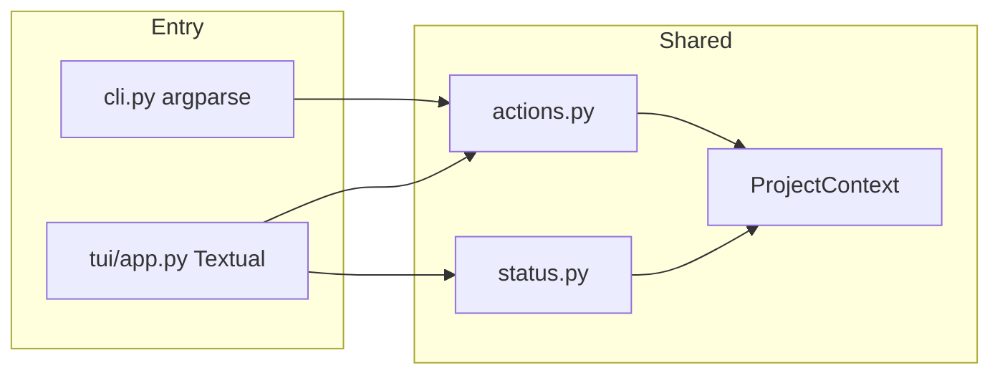

# Опциональный Textual TUI поверх CLI

## Решение

- Стек: **Textual** в optional-зависимости `[tui]` (`pip install -e ".[tui]"`).
- Вход: команда `offline-docker tui` (CLI без аргументов не меняем — `required=True` у subcommands сохраняем).
- MVP-экраны: **выбор/путь проекта → статус кэша → список команд → live-лог запуска**.
- Без веб/десктоп UI; `configure`-wizard в TUI не делаем в этом шаге (остаётся CLI `configure`).

## Архитектура

1. Вынести dispatch из [`src/offline_docker/cli.py`](src/offline_docker/cli.py) в новый [`src/offline_docker/actions.py`](src/offline_docker/actions.py): чистые функции вида `run_action(name, ctx, **opts)` для всех текущих handlers (`discover`, `download-*`, `validate`, `build`, `up`, `scan`, …).
2. CLI вызывает тот же `run_action` — поведение команд не меняется.
3. TUI запускает `run_action` в worker-потоке и показывает stdout/stderr в лог-панели.

## Минимальный рефакторинг вывода

Полный перевод всех `print()` на callbacks не делаем (слишком широко). Для MVP:

- В [`docker_cmd.py`](src/offline_docker/docker_cmd.py) оставить как есть.
- В TUI: при запуске действия временно перехватывать `sys.stdout`/`sys.stderr` через thread-safe sink → виджет `RichLog` / `Log`.
- Для статуса кэша — отдельный structured API, не парсинг текста.

Новый [`src/offline_docker/status.py`](src/offline_docker/status.py):

- `CacheStatusItem(level, label, detail)` + `collect_cache_status(ctx) -> CacheStatusReport`.
- Логику проверок взять из [`validate.py`](src/offline_docker/validate.py) (wheels/debs/npm/yarn/docker/trivy dirs, hash checks), но **вернуть список items**, а не только `print` + `SystemExit`.
- [`validate_offline_cache`](src/offline_docker/validate.py) переписать тонко: вызвать `collect_cache_status`, напечатать как сейчас, при ошибках — `SystemExit(1)`. Поведение CLI сохраняется.

Discover в TUI: использовать уже готовый `format_discovery_report(ctx.config)`.

## Структура TUI

Новый пакет `src/offline_docker/tui/`:

| Файл | Назначение |
|------|------------|
| `__init__.py` | `run_tui(project: Path \| None)` |
| `app.py` | `OfflineDockerApp(App)` — экраны/bindings |
| `screens.py` | Home (project path + Refresh), Status table, Command picker, Run log |
| `runner.py` | worker + stdout bridge + вызов `actions.run_action` |

UI-поток:

1. **Home**: путь `-p` / cwd, кнопка Refresh статуса, краткая сводка OK/WARN/ERROR.
2. **Status**: таблица items из `collect_cache_status` + кнопка «Discover report» (текст в модалке/панели).
3. **Commands**: список действий (download-offline-cache, validate, load, build-offline, up-offline, scan backend/frontend, …) с простыми флагами (`--lab`, `--no-cache`, targets).
4. **Run**: live-лог, Escape → назад; во время run кнопки disabled.

Ошибки Textual ImportError: в `cli.py` для `tui` печатать коротко: `pip install -e ".[tui]"`.

## Изменения в packaging / docs

- [`pyproject.toml`](pyproject.toml): `tui = ["textual>=0.80"]` в `optional-dependencies`; classifier можно оставить Console.
- [`README.md`](README.md): короткий блок «Опциональный TUI» — установка и `offline-docker tui -p .`.
- Версию не бампим отдельно, если не просили; changelog-строку добавить в README Changelog как пункт 1.3.x / next.

## Тесты

- `tests/test_status.py` — на временном дереве без кэша: `collect_cache_status` даёт ERROR/WARN items, не падает.
- `tests/test_actions.py` — `discover` через `run_action` возвращает/печатает без Docker (discover не требует docker; для docker-команд не гоняем в CI).
- TUI UI-тесты Textual не обязательны в MVP.

## Вне scope этого шага

- Wizard `configure` внутри TUI.
- Переписывание всех download/build модулей на callback API.
- Запуск TUI по умолчанию без subcommand.
- Веб-UI.