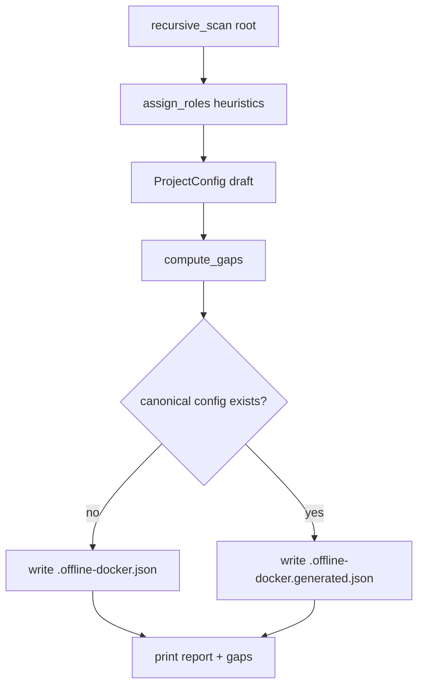

# План: рекурсивный discover/init + авто-JSON черновик

## Границы (явно не делаем)

- LLM / генерация содержимого `Dockerfile.*.offline` / `docker-compose.offline.yml`
- Полный цикл «чужой репо без offline-обвязки → build/up»
- Перезапись существующего `.offline-docker.json` / `.yaml`

## Зафиксированные решения

- Общий рекурсивный инвентарь для **`discover` и `init`** (один сканер).
- Канон отсутствует → писать [`.offline-docker.json`](.offline-docker.json).
- Канон уже есть (`.offline-docker.json` / `.yaml` / `.yml`) → писать **`.offline-docker.generated.json`**, канон не трогать.
- Повторный `init` **перезаписывает** только `.generated.json` (или канон, если его ещё не было и пользователь не создал файл между запусками).
- В черновик JSON добавляется служебная секция `_init` (merge в [`config.py`](src/offline_docker/config.py) её игнорирует) с gaps и путём вывода.

## 1. Рекурсивный сканер

Новый модуль [`src/offline_docker/scan.py`](src/offline_docker/scan.py) (или расширение [`discover.py`](src/offline_docker/discover.py) — предпочтительно отдельный `scan.py`, чтобы не раздувать discover):

- Обход `root.rglob` с **исключениями каталогов**: `.git`, `node_modules`, `.venv`, `venv`, `__pycache__`, `offline-cache`, `.tox`, `dist`, `build`, `.mypy_cache`, `.ruff_cache`, `coverage`, `.idea`, `.cursor` (и аналоги).
- Собирать относительные пути:
  - compose: `docker-compose*.yml` / `*.yaml`
  - Dockerfiles: имена `Dockerfile`, `Dockerfile.*`
  - Python: `pyproject.toml`, `uv.lock`, `requirements*.txt`
  - Frontend: `package.json`, `package-lock.json`, `yarn.lock`, `pnpm-lock.yaml`
- Dataclass `ScanInventory` со списками найденного.

## 2. Назначение ролей (эвристики шире шаблона)

Функция `inventory_to_draft_config(root, inventory) -> ProjectConfig`:

| Поле | Правило |
|------|---------|
| `frontend_dir` | каталог с lock (`package-lock.json` / `yarn.lock` / `pnpm-lock.yaml`), иначе с `package.json`; приоритет имён `frontend`/`web`/`ui`/`client`/`fe_mt_react`, иначе самый мелкий путь |
| `frontend_lock` | фактическое имя найденного lock |
| `python_lock_files` | найденные файлы; приоритет корня, затем рядом с backend Dockerfile |
| `dockerfiles.*` | по суффиксам/именам: `*.offline`, `Dockerfile.base`, путь содержит `frontend` → frontend; иначе дефолты из [`DockerfilesConfig`](src/offline_docker/config.py) |
| compose online/offline | как сейчас + рекурсивно найденные; `*offline*` → offline, без offline/lab → online |
| `deb_packages` | `parse_apt_packages_from_dockerfiles` по найденным base/backend Dockerfile |
| `docker_images` | union: `DEFAULT_DOCKER_IMAGES` + простые `FROM image:tag` из найденных Dockerfile (без `AS`, без build-args) |
| `images` / `app_name` | существующие эвристики из compose / имени репо |

`discover_project` перевести на этот пайплайн (вместо узких hardcoded-only путей), чтобы `load_config` без JSON тоже стал шире — с теми же эвристиками.

## 3. Список gaps / missing artifacts

Функция `compute_init_gaps(cfg, inventory) -> list[str]` — явные пункты «доработать вручную», например:

- нет `Dockerfile.offline` / `Dockerfile.base.offline` / frontend offline
- нет compose с `offline` в имени
- не найден frontend lock / python lock
- `dockerfiles.*` указывают на отсутствующие файлы
- несколько кандидатов frontend/python (ambiguity → warning в gaps)
- пустой `deb_packages` после парсинга (остались только defaults — пометка)

**Не** генерировать offline-файлы — только перечислить.

Расширить [`format_discovery_report`](src/offline_docker/discover.py): секция `Missing / to fix:` + при ambiguity — краткий список альтернатив из inventory.

## 4. Команда `offline-docker init`

В [`cli.py`](src/offline_docker/cli.py):

- `init` с `-p` (без обязательного `--config` для записи).
- Флаги: `--dry-run` (только отчёт, без записи), `--stdout` не нужен.
- Логика вывода:
  1. scan → draft config → gaps
  2. сериализовать в dict по форме [`examples/offline-docker.json.example`](examples/offline-docker.json.example)
  3. добавить `_init`: `{ "tool": "offline-docker", "output": "<rel>", "gaps": [...] }`
  4. выбрать путь: канон есть → `.offline-docker.generated.json`, иначе `.offline-docker.json`
  5. записать UTF-8 JSON indent=2; напечатать путь + тот же human-report с gaps
- `discover` по-прежнему печатает отчёт (уже с рекурсией + gaps), файл не пишет.
- `init` **не** требует Docker (`require_docker` обойти, как у `configure`).

Сериализация: новая `project_config_to_dict(cfg) -> dict` рядом с merge в [`config.py`](src/offline_docker/config.py) (обратное к `_merge_config_dict` для основных полей).

## 5. Документация

- [`README.md`](README.md): секция `init`, таблица имён выходных файлов, что gaps значат, что offline-Dockerfile не создаются.
- [`examples/README.md`](examples/README.md): одна строка про `init` → черновик.
- Кратко дописать в [`docs/analogs-analysis.md`](docs/analogs-analysis.md) не обязательно; лучше не трогать.

## 6. Тесты

Новый [`tests/test_init_scan.py`](tests/test_init_scan.py):

- временное дерево: `apps/web/package-lock.json`, `services/api/pyproject.toml`, корневой `Dockerfile`, без offline → gaps содержат offline-артефакты; JSON-черновик с верными путями
- канон `.offline-docker.json` уже есть → пишется `.generated.json`, канон не меняется
- канона нет → создаётся `.offline-docker.json`
- skip `node_modules` (ложный `package.json` внутри не попадает в frontend)
- `--dry-run` не создаёт файлов

## Порядок работ

1. `scan.py` + эвристики ролей + `compute_init_gaps`
2. Переключить `discover_project` / отчёт
3. `project_config_to_dict` + команда `init` в CLI
4. Тесты + README
