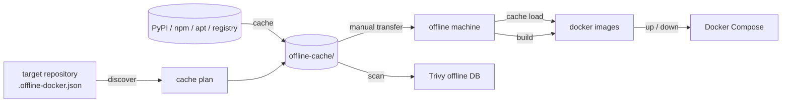

<div align="center">

<h1>offdock</h1>

A universal Python CLI for portable offline caches, offline Docker image builds and Trivy scanning of Docker projects.<br>
All configuration lives in the target repository (`.offline-docker.json`); the CLI stores no project-specific settings.

<a href="../LICENSE"></a>


<sub>English · <a href="../README.md">Русская версия</a> · <a href="../CONTRIBUTING.md">Contributing</a> · <a href="../SECURITY.md">Security</a> · <a href="../CHANGELOG.md">Changelog</a></sub>

</div>

---

## Contents

- [How it works](#how-it-works)
- [Features](#features)
- [Installation](#installation)
- [Quick start](#quick-start)
- [Commands](#commands)
- [Common flags](#common-flags)
- [Command examples](#command-examples)
- [Target project configuration](#target-project-configuration)
- [Package sources (local / ProGet / Nexus)](#package-sources-local--proget--nexus)
- [Environment variables](#environment-variables)
- [Requirements](#requirements)
- [Development and tests](#development-and-tests)
- [Repository layout](#repository-layout)
- [Limitations](#limitations)
- [Contributing](#contributing)
- [License](#license)
- [Changelog](#changelog)

## How it works



The `offline-cache/` bundle is transferred to the offline machine manually — there is no permanent mirror or registry service. Compose files are assembled from `compose_build` / `compose_up_offline` in the project config.

## Features

| Feature | What it gives you |
|---------|-------------------|
| Project-scoped config | Everything in the target repository: `.offline-docker.json` (or `.yaml`); the CLI stores no project settings |
| Portable offline cache | debs, wheels, npm, yarn, docker images and the Trivy DB in one transferable folder |
| Sources local → ProGet → Nexus | `resolve.order`, user-level `sources.json`, project override |
| `cache wheels` | Python taken from the base image + ABI version check |
| `cache debs` | Cache bound to the guest image distribution (`debs/.base-os`) |
| `hooks.after_cache` + `validation.critical_vendor` | Project hooks after caching and validation of critical vendor artifacts |
| `build` | Offline build with merge files and a service list |
| `up` / `down` | Compose in offline / lab / online modes |
| Trivy scan | Offline DB and log in `{log_dir}` |
| Optional Textual TUI | Cache status, command menu and live log on top of the same CLI actions |

## Installation

### Option A — without pip (recommended in a corp network)

```powershell
# from the offline-docker-cli repository root
.\offdock.cmd discover -p ..\my-project
```

### Option B — PyPI

```powershell
pip install offline-docker-cli
pip install "offline-docker-cli[yaml]"   # optional: .offline-docker.yaml
pip install "offline-docker-cli[tui]"    # optional: Textual TUI
offdock configure          # ProGet/Nexus URLs (Enter = offline cache only)
```

### Option C — from source (for development)

```powershell
cd offline-docker-cli
pip install -e ".[dev]"
```

### Optional TUI

A terminal UI on top of the same commands (cache status, menu, live log). The CLI remains the primary interface.

```powershell
# Regular install from PyPI
pip install "offline-docker-cli[tui]"

# For CLI development
pip install -e ".[tui]"

# Run
offdock tui -p .
```

**Important:** an editable install (`-e`) ties the package to the source folder — moving or deleting that folder breaks the CLI. For regular use, install from PyPI or use a normal install without `-e`.

## Quick start

Generate a draft config (recursive scan) or copy the template from `examples/`:

```powershell
cd ..\my-project
offdock init -p .          # → .offline-docker.json (or .generated.json)
offdock discover -p .
offdock cache -p .
offdock cache check -p .   # verify the offline cache is complete
offdock build -p .
offdock up -p .
```

### `init` — config draft

Recursively finds compose files, Dockerfiles and python/frontend lock files, then writes JSON matching the example schema.

| Situation | File |
|-----------|------|
| No `.offline-docker.json` / `.yaml` | `.offline-docker.json` is created |
| Canonical config already exists | `.offline-docker.generated.json` is written (the canonical file is **not** overwritten) |

The JSON contains a `_init.gaps` section and stdout shows a `Missing / to fix:` block (no `Dockerfile.*.offline`, no offline compose, etc.).
The offline Dockerfiles / compose files themselves are **not** generated — only paths and a list of fixes.

```powershell
offdock init -p . --dry-run   # report only
```

## Commands

| Command | Description |
|---------|-------------|
| `configure` | User-level ProGet/Nexus (or local-only) |
| `tui` | Interactive Textual TUI (requires `pip install …[tui]`) |
| `init` | Recursive scan → `.offline-docker.json` draft (+ gaps) |
| `discover` | Compose, Python/npm lock files, Dockerfile, APT packages, sources, Missing |
| `cache` | Full offline cache download |
| `cache wheels\|debs\|npm\|yarn\|images\|trivy` | Partial download |
| `cache check` | Verify cache completeness |
| `cache load` | `docker load` from `offline-cache/docker/` |
| `build [base backend frontend]` | Offline build |
| `up [--lab\|--online] […]` | Compose up (offline / lab / online) |
| `down [--lab\|--online] [services]` | Compose down for the same stack |
| `scan [trivy] <backend\|frontend> [image]` | Scan an image (default: trivy) |

## Common flags

- `--project PATH` / `-p` — target project root (default: current directory)
- `--config PATH` — explicit config path (default: `.offline-docker.json` in the project root)

Help and examples are available in `--help` (global and per command):

```powershell
offdock --help
offdock scan --help
offdock up --help
```

## Command examples

Paths are relative: commands run from the `offline-docker-cli` root, and the target project is the sibling directory `my-project`.

### Preparation and build

```powershell
# Full cache preparation cycle (on a machine with internet access)
offdock cache -p ..\my-project

# On the offline machine: load images and build
offdock cache load -p .
offdock build -p .
offdock cache check -p .

# Build only the backend (without base/frontend)
offdock build -p . backend
```

### `up` / `down` and the `--lab` / `--online` modes

Regular offline stack (merge files from `compose_up_offline` in the config):

```powershell
offdock up -p .
offdock down -p .
```

Home lab — additionally includes `docker-compose.lab.yml`:

```powershell
offdock up -p . --lab
offdock down -p . --lab
```

Online — `compose_online` only:

```powershell
offdock up -p . --online
offdock down -p . --online
```

What the **target project** needs for `--lab`:

1. A `docker-compose.lab.yml` file in the repository root (override for the home environment).
2. A `compose_up_offline_lab` section in `.offline-docker.json` listing compose files (see `../examples/offline-docker.json.example`). If the section is absent, the CLI appends `docker-compose.lab.yml` to the `compose_up_offline` list.

More about config fields: [`../examples/README.md`](../examples/README.md).

Additional flags:

```powershell
# Do not rebuild images (already built)
offdock up -p . --no-build

# Bring up only the backend without recreating dependencies
offdock up -p . --no-deps backend

# Lab + frontend only
offdock up -p . --lab frontend

# Stop individual services
offdock down -p . backend frontend
```

### `scan`

**Required** target: `backend` or `frontend`.
Optionally — the scanner (`trivy`, default) and the image tag.

```powershell
# Scan the backend image from the config (images.backend)
offdock scan backend

# Explicitly specify the scanner
offdock scan trivy frontend

# Explicit image tag
offdock scan trivy backend myapp-backend:cuda12
```

Before scanning:

1. The image must exist locally (`docker images`) — usually after `build`.
2. The Trivy DB must be in `offline-cache/trivy/` — `cache trivy` or `cache` (on a machine with internet access); on the offline machine the CLI tries to use the cache and warns if the DB is stale.
3. The `aquasec/trivy:latest` scanner image must be listed in `docker_images` in the config and loaded via `cache load`.

Scan parameters (`severity`, `scanners`, `db_max_age_days`) live in the `trivy` section of the config:

```json
"trivy": {
  "scanner_image": "aquasec/trivy:latest",
  "db_max_age_days": 7,
  "severity": "HIGH,CRITICAL",
  "scanners": "vuln"
}
```

The log is written to `{log_dir}/trivy-scan-{backend|frontend}.log` (default: `storage/logs/`).

## Target project configuration

1. **`.offline-docker.json`** (or `.offline-docker.yaml`) in the repository root — **canonical**
2. **Auto-discovery** — fallback when there is no config (for `discover`; a config is recommended for `build`)

Example: `../examples/offline-docker.json.example` — copy it to the project root as `.offline-docker.json`.

## Package sources (local / ProGet / Nexus)

By default the CLI uses **only the local** `offline-cache/`.

After installation, configure the corporate registries (once per machine):

```powershell
offdock configure
# populate the cache from the internet (local + PyPI/npmjs):
offdock configure --with-upstream
# offline cache only (corp/offline VM):
offdock configure --local-only
offdock configure --proget-url https://proget.example.com --nexus-url http://nexus.example.com:8081
```

The config is written to a user-level file (not to the project example):

- Linux/macOS: `~/.config/offline-docker/sources.json`
- Windows: `%APPDATA%\offline-docker\sources.json`
- directory override: `OFFLINE_DOCKER_CONFIG_DIR`

Priority: **project `.offline-docker.json` → `cache` section** overrides the user config; otherwise the user config; otherwise local-only.

| Mode | When |
|------|------|
| `--with-upstream` | Machine with network: `cache` / `cache wheels` pulls from PyPI/npmjs into `offline-cache/` |
| `--local-only` | Offline/corp VM: build only from the already downloaded cache |
| ProGet/Nexus | Corp mirrors; order in `resolve.order` |

The lookup order is set by `resolve.order` (for example `local,upstream` or `local,proget,nexus`). `cache wheels` / `cache npm` walk the index URL chain and append artifacts to the local folder (`fill_local`).

If `sources.json` is set to **local-only**, `cache wheels` still temporarily adds PyPI/PyTorch (with a WARN) and, before downloading, removes **stale** wheels whose version does not match the pin in the lock/requirements (a typical case is `protobuf==7.x` with an old `6.x` in the cache).

Auth (optional, via env, not in JSON): `PROGET_API_KEY`, `NEXUS_AUTH` (`user:pass` or Bearer).

For Nexus over HTTP, pip automatically receives `--trusted-host`; npm gets `strict-ssl false`.

Env: `OFFLINE_RESOLVE_ORDER=local,proget,nexus` — temporary order override.

The project template (`../examples/offline-docker.json.example`) is **neutral** — no corporate URLs.

## Environment variables

| Variable | Purpose |
|----------|---------|
| `OFFLINE_CACHE` | Path to the offline cache (override) |
| `{APP_NAME}_OFFLINE_CACHE` | Alias from `app_name` in the config |
| `OFFLINE_DOCKER_CONFIG_DIR` | User config directory (`sources.json`) |
| `OFFLINE_RESOLVE_ORDER` | Comma-separated source order |
| `PROGET_API_KEY` / `NEXUS_AUTH` | Auth for remote sources |
| `PYTORCH_INDEX` | Index URL for torch wheels |
| `PYPI_INDEX` | Force the primary PyPI index |
| `DOCKER_BUILDKIT` | `1` for build |

## Requirements

- Python 3.11+
- Docker (CLI on PATH)

## Development and tests

```bash
uv sync --extra dev      # .venv with pyyaml, textual, pytest
uv run pytest -q         # the whole tests/ suite
uv run offdock --version
uv run offdock --help
```

- After changing dependencies — run `uv lock` and commit `uv.lock`.
- Keep the version in sync in `pyproject.toml` and `src/offline_docker/__init__.py`.
- Verify against a real project: `offdock discover -p ..\my-project`.
- Run without installing — `offdock.cmd` (`PYTHONPATH=src`, `python -m offline_docker`).

## Repository layout

```
offline-docker-cli/
├── .github/               # EN README, issue/PR templates, GitHub Actions
├── docs/ru/               # RU versions of CONTRIBUTING / SECURITY / CHANGELOG
├── examples/              # .offline-docker.json templates
├── src/offline_docker/    # CLI, cache, build, scan, TUI
├── tests/                 # pytest
├── .gitattributes
├── .gitlab-ci.yml         # GitLab CI
├── AGENTS.md              # agent rules
├── CONTRIBUTING.md        # EN
├── SECURITY.md            # EN
├── CHANGELOG.md           # EN
├── LICENSE
├── offdock.cmd            # run without installing (Windows)
├── pyproject.toml
└── README.md              # RU (Russian version)
```

## Limitations

- Not a LAN mirror: a portable bundle, no permanent registry service.
- `build` / `up` require Docker.
- The Trivy DB ages; `db_max_age_days` only warns, it does not block.
- Images are pulled by tag (digests are not pinned).
- Project-specific configs are not stored in the CLI.

## Contributing

Development and verification rules — [../CONTRIBUTING.md](../CONTRIBUTING.md). Security policy — [../SECURITY.md](../SECURITY.md); do not report vulnerabilities in a public issue.

## License

[MIT](../LICENSE) © 2026 D.Shapovalov.

## Changelog

Full history — [../CHANGELOG.md](../CHANGELOG.md).
