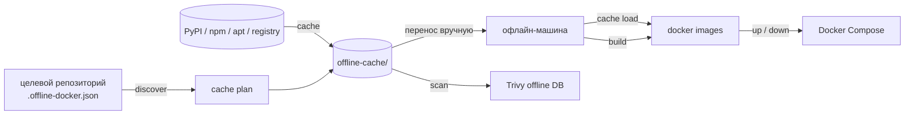

<div align="center">

<h1>offdock</h1>

Универсальная Python CLI для portable offline-cache, офлайн-сборки Docker-образов и Trivy-сканирования Docker-проектов.<br>
Весь конфиг живёт в целевом репозитории (`.offline-docker.json`); CLI не содержит настроек конкретных проектов.

<a href="LICENSE"></a>


<sub><a href=".github/README.md">English</a> · Русская версия · <a href="docs/ru/CONTRIBUTING.md">Участие</a> · <a href="docs/ru/SECURITY.md">Безопасность</a> · <a href="docs/ru/CHANGELOG.md">Changelog</a></sub>

</div>

---

## Содержание

- [Как это работает](#как-это-работает)
- [Возможности](#возможности)
- [Установка](#установка)
- [Быстрый старт](#быстрый-старт)
- [Команды](#команды)
- [Общие флаги](#общие-флаги)
- [Примеры команд](#примеры-команд)
- [Конфигурация целевого проекта](#конфигурация-целевого-проекта)
- [Источники пакетов (local / ProGet / Nexus)](#источники-пакетов-local--proget--nexus)
- [Env-переменные](#env-переменные)
- [Требования](#требования)
- [Разработка и тесты](#разработка-и-тесты)
- [Структура репозитория](#структура-репозитория)
- [Ограничения](#ограничения)
- [Участие](#участие)
- [Лицензия](#лицензия)
- [Changelog](#changelog)

## Как это работает



Бандл-папка `offline-cache/` переносится на офлайн-машину вручную — постоянного зеркала/registry-сервиса нет. Compose-файлы склеиваются из `compose_build` / `compose_up_offline` конфига проекта.

## Возможности

| Возможность | Что даёт |
|-------------|----------|
| Project-scoped конфиг | Всё в целевом репозитории: `.offline-docker.json` (или `.yaml`); CLI не хранит проектные настройки |
| Portable offline-cache | debs, wheels, npm, yarn, docker images, Trivy DB в одной переносимой папке |
| Источники local → ProGet → Nexus | `resolve.order`, user-level `sources.json`, project override |
| `cache wheels` | Python берётся из базового образа + ABI-проверка версии |
| `cache debs` | Кэш привязан к дистрибутиву гостевого образа (`debs/.base-os`) |
| `hooks.after_cache` + `validation.critical_vendor` | Проектные хуки после кэша и проверка критичных vendor-артефактов |
| `build` | Офлайн-сборка с merge-файлами и списком сервисов |
| `up` / `down` | Offline / lab / online режимы Compose |
| Trivy-скан | Офлайн-БД и лог в `{log_dir}` |
| Опциональный Textual TUI | Статус кэша, меню команд и live-лог поверх тех же действий CLI |

## Установка

### Вариант A — без pip (рекомендуется в corp-сети)

```powershell
# из корня репозитория offline-docker-cli
.\offdock.cmd discover -p ..\my-project
```

### Вариант B — PyPI

```powershell
pip install offline-docker-cli
pip install "offline-docker-cli[yaml]"   # опционально: .offline-docker.yaml
pip install "offline-docker-cli[tui]"    # опционально: Textual TUI
offdock configure          # ProGet/Nexus URL (Enter = только offline-cache)
```

### Вариант C — из исходников (для разработки)

```powershell
cd offline-docker-cli
pip install -e ".[dev]"
```

### Опциональный TUI

Терминальный UI поверх тех же команд (статус кэша, меню, live-лог). CLI остаётся основным интерфейсом.

```powershell
# Обычная установка из PyPI
pip install "offline-docker-cli[tui]"

# Для разработки самого CLI
pip install -e ".[tui]"

# Запуск
offdock tui -p .
```

**Важно:** editable-установка (`-e`) привязывает пакет к папке исходников — если папку переместить/удалить, CLI сломается. Для использования ставьте пакет из PyPI или обычной установкой без `-e`.

## Быстрый старт

Сгенерировать черновик конфига (рекурсивный scan) или скопировать шаблон из `examples/`:

```powershell
cd ..\my-project
offdock init -p .          # → .offline-docker.json (или .generated.json)
offdock discover -p .
offdock cache -p .
offdock cache check -p .   # проверка полноты offline-cache
offdock build -p .
offdock up -p .
```

### `init` — черновик конфига

Рекурсивно ищет compose, Dockerfile, python/frontend lock-файлы и пишет JSON по схеме example.

| Ситуация | Файл |
|----------|------|
| Нет `.offline-docker.json` / `.yaml` | создаётся `.offline-docker.json` |
| Канон уже есть | пишется `.offline-docker.generated.json` (канон **не** затирается) |

В JSON есть секция `_init.gaps` и в stdout — блок `Missing / to fix:` (нет `Dockerfile.*.offline`, offline-compose и т.д.).
**Не** генерируются сами offline-Dockerfile / compose — только пути и список доработок.

```powershell
offdock init -p . --dry-run   # только отчёт
```

## Команды

| Команда | Описание |
|---------|----------|
| `configure` | User-level ProGet/Nexus (или local-only) |
| `tui` | Интерактивный Textual TUI (нужен `pip install …[tui]`) |
| `init` | Рекурсивный scan → черновик `.offline-docker.json` (+ gaps) |
| `discover` | Compose, Python/npm lock, Dockerfile, APT-пакеты, sources, Missing |
| `cache` | Полный download offline-cache |
| `cache wheels\|debs\|npm\|yarn\|images\|trivy` | Частичный download |
| `cache check` | Проверка полноты кэша |
| `cache load` | `docker load` из `offline-cache/docker/` |
| `build [base backend frontend]` | Офлайн-сборка |
| `up [--lab\|--online] […]` | Compose up (offline / lab / online) |
| `down [--lab\|--online] [services]` | Compose down того же стека |
| `scan [trivy] <backend\|frontend> [image]` | Скан образа (default: trivy) |

## Общие флаги

- `--project PATH` / `-p` — корень целевого проекта (default: текущий каталог)
- `--config PATH` — явный путь к конфигу (default: `.offline-docker.json` в корне проекта)

Справка и примеры — в `--help` (общий и по команде):

```powershell
offdock --help
offdock scan --help
offdock up --help
```

## Примеры команд

Пути относительны: команды запускаются из корня `offline-docker-cli`, целевой проект — соседний каталог `my-project`.

### Подготовка и сборка

```powershell
# Полный цикл подготовки кэша (на машине с интернетом)
offdock cache -p ..\my-project

# На офлайн-машине: загрузить образы и собрать
offdock cache load -p .
offdock build -p .
offdock cache check -p .

# Собрать только backend (без base/frontend)
offdock build -p . backend
```

### `up` / `down` и режимы `--lab` / `--online`

Обычный offline-стек (merge-файлы из `compose_up_offline` в конфиге):

```powershell
offdock up -p .
offdock down -p .
```

Home lab — дополнительно подключается `docker-compose.lab.yml`:

```powershell
offdock up -p . --lab
offdock down -p . --lab
```

Online — только `compose_online`:

```powershell
offdock up -p . --online
offdock down -p . --online
```

Что нужно в **целевом проекте** для `--lab`:

1. Файл `docker-compose.lab.yml` в корне репозитория (override для домашней среды).
2. В `.offline-docker.json` — секция `compose_up_offline_lab` со списком compose-файлов (см. `examples/offline-docker.json.example`). Если секция не задана, CLI сам добавит `docker-compose.lab.yml` к списку из `compose_up_offline`.

Подробнее о полях конфига: [`examples/README.md`](examples/README.md).

Дополнительные флаги:

```powershell
# Не пересобирать образы (уже собраны)
offdock up -p . --no-build

# Поднять только backend, без пересоздания зависимостей
offdock up -p . --no-deps backend

# Lab + только frontend
offdock up -p . --lab frontend

# Остановить отдельные сервисы
offdock down -p . backend frontend
```

### `scan`

**Обязательный** target: `backend` или `frontend`.
Опционально — сканер (`trivy`, default) и тег образа.

```powershell
# Скан backend-образа из конфига (images.backend)
offdock scan backend

# Явно указать сканер
offdock scan trivy frontend

# Явный тег образа
offdock scan trivy backend myapp-backend:cuda12
```

Перед сканом:

1. Образ должен существовать локально (`docker images`) — обычно после `build`.
2. БД Trivy в `offline-cache/trivy/` — `cache trivy` или `cache` (на машине с интернетом); на офлайн-машине CLI попытается использовать кэш и предупредит, если БД устарела.
3. Образ сканера `aquasec/trivy:latest` — в `docker_images` конфига, загружается через `cache load`.

Параметры сканирования (`severity`, `scanners`, `db_max_age_days`) — в секции `trivy` конфига:

```json
"trivy": {
  "scanner_image": "aquasec/trivy:latest",
  "db_max_age_days": 7,
  "severity": "HIGH,CRITICAL",
  "scanners": "vuln"
}
```

Лог пишется в `{log_dir}/trivy-scan-{backend|frontend}.log` (default: `storage/logs/`).

## Конфигурация целевого проекта

1. **`.offline-docker.json`** (или `.offline-docker.yaml`) в корне репозитория — **канон**
2. **Auto-discovery** — fallback, если конфига нет (для `discover`; для build рекомендуется конфиг)

Пример: `examples/offline-docker.json.example` — скопируйте в корень проекта как `.offline-docker.json`.

## Источники пакетов (local / ProGet / Nexus)

По умолчанию CLI использует **только локальный** `offline-cache/`.

После установки настройте корпоративные реестры (один раз на машину):

```powershell
offdock configure
# заполнение кэша с интернета (local + PyPI/npmjs):
offdock configure --with-upstream
# только offline-cache (корп/офлайн VM):
offdock configure --local-only
offdock configure --proget-url https://proget.example.com --nexus-url http://nexus.example.com:8081
```

Конфиг пишется в user-level файл (не в example проекта):

- Linux/macOS: `~/.config/offline-docker/sources.json`
- Windows: `%APPDATA%\offline-docker\sources.json`
- override каталога: `OFFLINE_DOCKER_CONFIG_DIR`

Приоритет: **project `.offline-docker.json` → секция `cache`** перекрывает user-config; иначе user; иначе local-only.

| Режим | Когда |
|-------|--------|
| `--with-upstream` | Машина с сетью: `cache` / `cache wheels` тянет с PyPI/npmjs в `offline-cache/` |
| `--local-only` | Офлайн/корп VM: сборка только из уже скачанного кэша |
| ProGet/Nexus | Корп. зеркала; порядок в `resolve.order` |

Порядок поиска задаётся `resolve.order` (например `local,upstream` или `local,proget,nexus`). `cache wheels` / `cache npm` ходят по цепочке index URL и дописывают артефакты в локальную папку (`fill_local`).

Если в `sources.json` стоит **local-only**, `cache wheels` всё равно временно добавляет PyPI/PyTorch (с WARN) и перед скачиванием удаляет **устаревшие** wheels, чья версия не совпадает с pin в lock/requirements (типичный случай `protobuf==7.x` при старом `6.x` в кэше).

Auth (опционально, через env, не в JSON): `PROGET_API_KEY`, `NEXUS_AUTH` (`user:pass` или Bearer).

Для Nexus по HTTP pip автоматически получает `--trusted-host`; npm — `strict-ssl false`.

Env: `OFFLINE_RESOLVE_ORDER=local,proget,nexus` — временный override порядка.

Шаблон проекта (`examples/offline-docker.json.example`) **нейтральный** — без корпоративных URL.

## Env-переменные

| Переменная | Назначение |
|------------|------------|
| `OFFLINE_CACHE` | Путь к offline-cache (override) |
| `{APP_NAME}_OFFLINE_CACHE` | Alias из `app_name` в конфиге |
| `OFFLINE_DOCKER_CONFIG_DIR` | Каталог user-config (`sources.json`) |
| `OFFLINE_RESOLVE_ORDER` | Порядок sources через запятую |
| `PROGET_API_KEY` / `NEXUS_AUTH` | Auth для remote |
| `PYTORCH_INDEX` | Index URL для torch wheels |
| `PYPI_INDEX` | Force primary PyPI index |
| `DOCKER_BUILDKIT` | `1` для build |

## Требования

- Python 3.11+
- Docker (CLI на PATH)

## Разработка и тесты

```bash
uv sync --extra dev      # .venv с pyyaml, textual, pytest
uv run pytest -q         # весь набор tests/
uv run offdock --version
uv run offdock --help
```

- После правок зависимостей — `uv lock` и коммит `uv.lock`.
- Версия синхронизируется в `pyproject.toml` и `src/offline_docker/__init__.py`.
- Проверка на реальном проекте: `offdock discover -p ..\my-project`.
- Запуск без установки — `offdock.cmd` (`PYTHONPATH=src`, `python -m offline_docker`).

## Структура репозитория

```
offline-docker-cli/
├── .github/               # EN README, шаблоны issue/PR, GitHub Actions
├── docs/ru/               # RU-версии CONTRIBUTING / SECURITY / CHANGELOG
├── examples/              # шаблоны .offline-docker.json
├── src/offline_docker/    # CLI, cache, build, scan, TUI
├── tests/                 # pytest
├── .gitattributes
├── .gitlab-ci.yml         # GitLab CI
├── AGENTS.md              # правила для агентов
├── CONTRIBUTING.md        # EN
├── SECURITY.md            # EN
├── CHANGELOG.md           # EN
├── LICENSE
├── offdock.cmd            # запуск без установки (Windows)
├── pyproject.toml
└── README.md              # RU (этот файл)
```

## Ограничения

- Не LAN-зеркало: portable бандл, без постоянного registry-сервиса.
- Для `build` / `up` нужен Docker.
- Trivy DB стареет; `db_max_age_days` только предупреждает, не блокирует.
- Образы тянутся по тегу (digest не пиннится).
- Конфиги конкретных проектов в CLI не хранятся.

## Участие

Правила разработки и проверки — [docs/ru/CONTRIBUTING.md](docs/ru/CONTRIBUTING.md). Политика безопасности — [docs/ru/SECURITY.md](docs/ru/SECURITY.md); уязвимости не публикуйте в публичном issue.

## Лицензия

[MIT](LICENSE) © 2026 D.Shapovalov.

## Changelog

Полная история изменений — [docs/ru/CHANGELOG.md](docs/ru/CHANGELOG.md).
